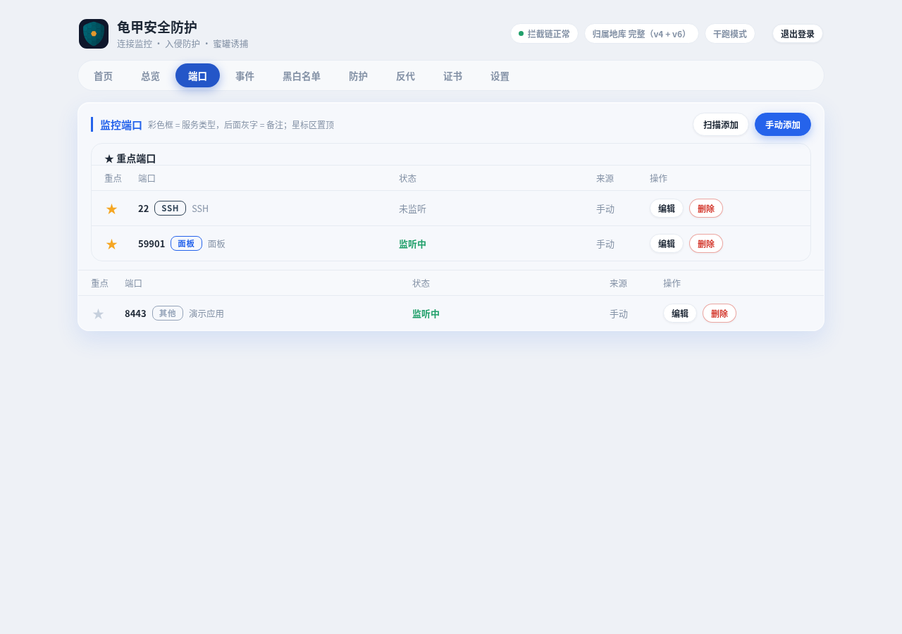
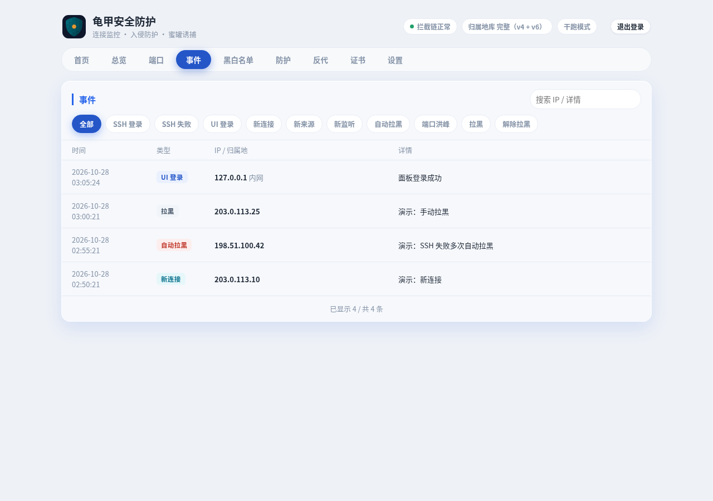
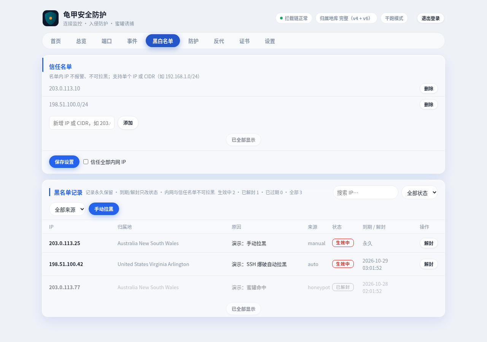
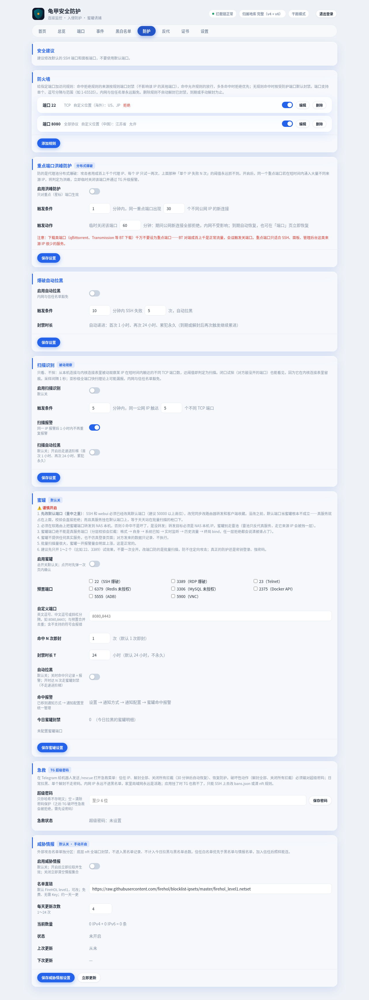
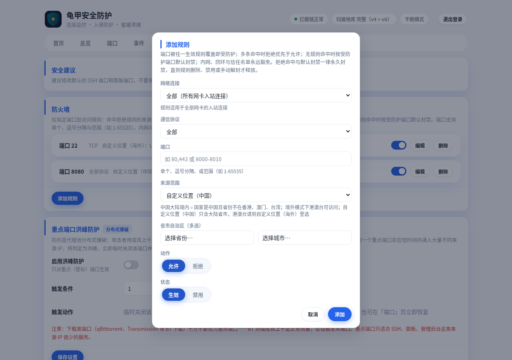
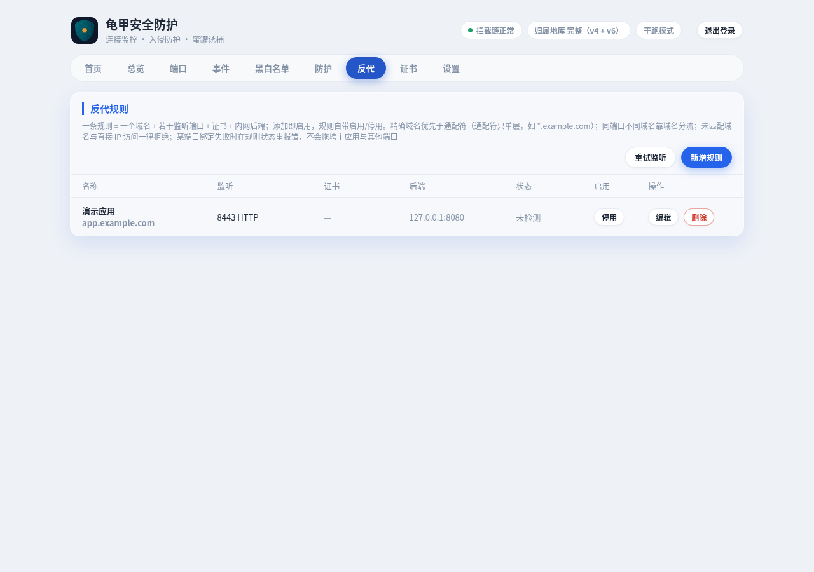
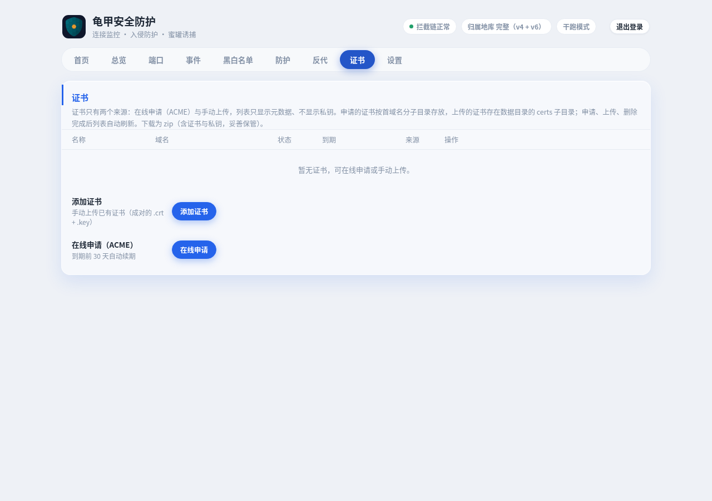
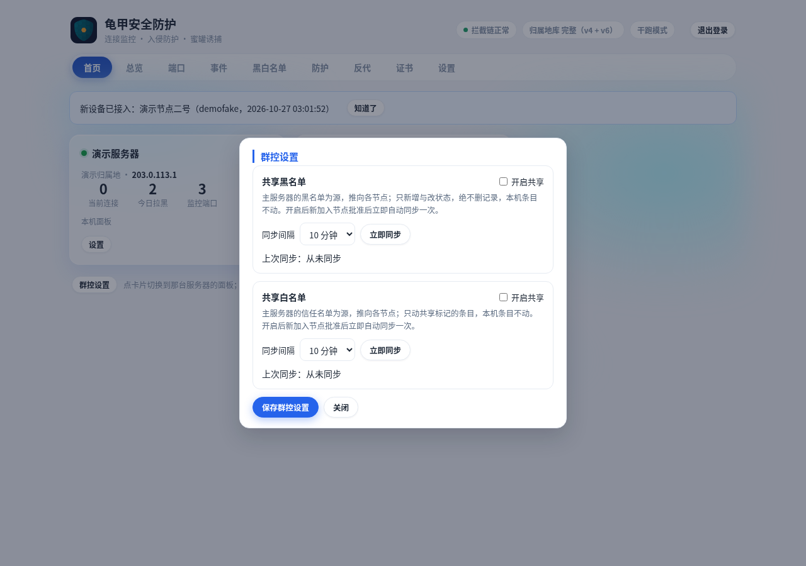
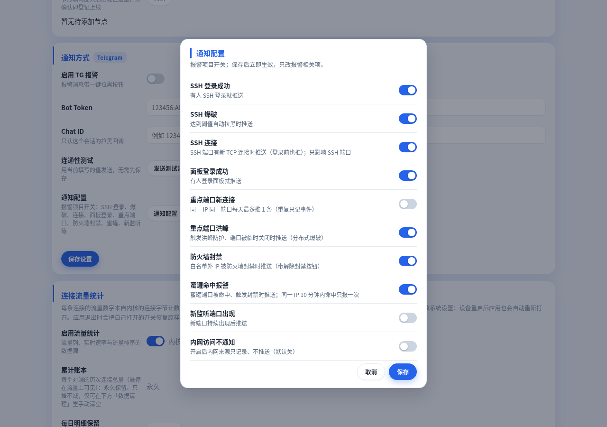
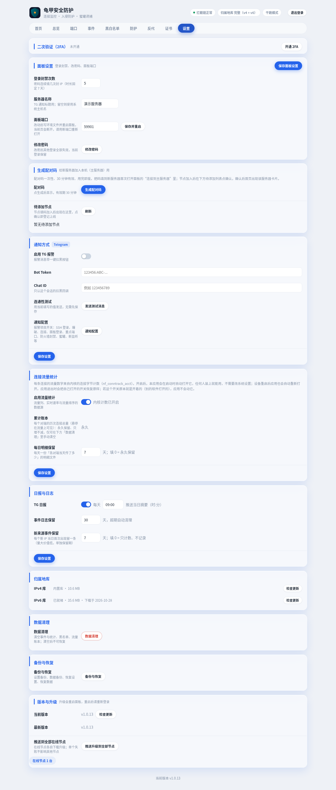

# 龟甲安全防护 Guijia

Linux 公网服务器（VPS / 云服务器）的安全防护面板：实时连接监控、入侵防护、蜜罐诱捕、多服务器群控。Go 单二进制 + nftables，systemd 或 Docker 运行。

> 本仓库是通用版，与飞牛 fnOS 版彻底分开。飞牛版独立维护，不在这里。
>
> 下面的截图全部来自本地演示实例与假数据（演示服务器名、文档段 IP、example.com 域名），不是生产面板截图。公开仓库里不放任何真实服务器信息。


## 功能总览

- **总览**：统计卡、当前登录会话、重点端口与其它端口实时连接
- **端口**：监控端口清单（扫描添加 / 手动添加，星标 = 重点端口）
- **事件**：全部安全事件，可按类型筛选、按 IP / 详情搜索
- **黑白名单**：信任名单 + 黑名单记录（记录永久保留）
- **防护**：防火墙、重点端口洪峰、爆破自动拉黑、扫描识别、蜜罐、急救、威胁情报
- **反代**：域名反代规则（SNI 分流，面板可接管 nginx vhost）
- **证书**：ACME 在线申请与手动上传，多 SAN 一张证书，到期自动续期
- **多服务器**：首页卡片群控、配对码加入、共享黑白名单、推送升级
- **设置**：2FA、面板设置、配对码、Telegram 通知、流量统计、日报、归属地库、数据清理、备份恢复、版本升级

## 总览


- 统计卡：当前连接、今日新来源 IP、今日拉黑次数、今日 SSH 失败、黑名单生效中 / 全部记录、监控端口。
- 今日拉黑口径：今日全部新增封禁动作数（手动、TG 一键拉黑、面板登录爆破、SSH 爆破、扫描、蜜罐、防火墙封禁各计 1 次；解封不计）。今日蜜罐封禁是其中的明细，不是另一套总数。启动时用当日事件重算校准，重启不失真。
- 当前登录会话卡片：登录 IP、归属地、登录时间、最后活跃、记住登录、是否当前会话，当前会话置顶。接口只返回这些字段，绝不返回 token；会话只在内存里，面板重启后清空，需重新登录。
- 重点端口 · 实时连接：加星标的端口，未信任在前，可按连接时长、流量排序；其它端口 · 实时连接：未加星标的监控端口。
- 连接只封新连接：已建立的连接不会被踢；端口防护与洪峰关端口都只影响新连接。

## 端口



- 监控端口清单：端口、备注名、服务类型、状态（监听中 / 未监听）、来源、操作（编辑 / 删除）。
- 星标 = 重点端口：星标区置顶，只有重点端口才吃洪峰防护；面板端口启动时自动补一条加星的「面板」条目。
- 添加方式：扫描添加（从当前监听里挑）或手动添加；不要把 BT 下载类端口设为重点端口，对端成百上千是正常流量，会误触发洪峰。

## 事件



- 全部安全事件按时间倒序：SSH 登录 / SSH 失败、面板登录、新连接、新来源、新监听、自动拉黑、端口洪峰、拉黑、解除拉黑等。
- 顶部按类型筛选，下方搜索框按 IP / 详情搜索；事件按天存文件，保留天数在设置里可调（新来源事件可单独设保留期，填 0 = 只计数、不记录）。

## 黑白名单



- 信任名单：名单内 IP 不报警、不可拉黑；支持单个 IP 或 CIDR。信任优先于一切：进了信任名单，即使在黑名单或情报名单里也能连。
- 信任全部内网 IP：勾选框，勾选后四段标准私网范围（192.168.0.0/16、10.0.0.0/8、172.16.0.0/12、fc00::/7）由后端隐式信任，绝不写进列表；该标志是本机策略，不随共享白名单外推。
- 黑名单记录：记录永久保留，到期、解封只改状态，不删记录；只有在数据清理里明确选了清空才会被清掉。页头显示「生效中 · 已解封 · 已过期 · 全部」，按全部记录计，不受下方筛选影响。
- 手动封禁护栏：内网、回环、信任名单一律拒绝拉黑；唯一剩下的口子是亲手封自己的公网 IP，解法是事先把自己的 IP 加进信任名单。
- 手动拉黑、解封、按状态 / 来源筛选、按 IP 搜索都在这一页。

## 防护



防护页的五项防护（洪峰、爆破自动拉黑、扫描识别、蜜罐、防火墙）新装默认全关，手动开启；已有设置文件里的开关保持原值，不会被默认值覆盖。

### 防火墙

- 规则 = 端口 + 协议 + 来源 + 动作（允许 / 拒绝）+ 生效 / 禁用；端口支持单个、逗号分隔与范围（如 1-65535）；多规则同端口合法，完全相同才判重复。
- 执行语义：拒绝命中 > 允许命中 > 默认封禁（默认取首个生效覆盖规则的作用域）；只封规则端口，绝不扩到全局；内网、回环、保留段、信任永远豁免。
- 拒绝命中与默认封禁一律永久封禁；规则删除或禁用时，释放该规则产生的全部封禁（状态变已解封，记录保留）；重启用不自动恢复，下次命中重新封禁；手动解封与清理释放不变。
- 来源八项：自定义 IP、全部 IPv4、全部 IPv6、中国大陆境内、中国大陆境外、自定义位置（中国）、自定义位置（海外）、全部 IP。
  - 大陆境内 = 国家是中国且省份不在港澳台；境外 = 屏蔽全部大陆 IP（港澳台可访问）。
  - 自定义位置（中国）：大陆省份多选（31 省，含自治区、直辖市）+ 城市多选（带所属省份，提交须省市成对），省份命中或城市命中即命中；省条目只比省份，不比城市。
  - 自定义位置（海外）：国家与地区多选（含港澳台地区级选项），中英文双语显示、中英文均可搜索。
  - 难判断 IP：私网、回环、链路本地、保留段永远不封；归属地未知的 IP 不命中任何国家 / 省份类允许规则，走默认封禁，原因记「归属地未知」；CDN / anycast 段以归属地库的国家结论判定。
- 旧格式规则在新版对话框里提示升级并禁用保存，卡片开关仍可用。



### 重点端口洪峰防护（分布式爆破）

- 防的是代理池分布式爆破：成百上千个代理 IP、每个 IP 只试一两次，单个 IP 失败 N 次的阈值永远抓不到。
- 只对重点（星标）端口生效；默认触发条件：1 分钟内同一重点端口出现 30 个不同公网 IP 的新连接；触发动作：临时关闭该端口 60 分钟，期间公网新连接全部拒绝，内网不受影响，到期自动恢复，也可在端口页立即恢复。

### 爆破自动拉黑

- 默认触发条件：10 分钟内 SSH 失败 5 次，自动拉黑；内网与信任名单豁免。
- 封禁递进：首次 1 小时、再次 24 小时、累犯永久（到期或解封后再次触发继续累进）。

### 扫描识别（被动观察）

- 只看、不探：从本机连接与内核连接表里被动观察某 IP 在短时间内触达的不同 TCP 端口数，达阈值即判定为扫描；闭口试探也能看见，因为它在内核连接表里留痕。
- 默认触发条件：5 分钟内同一公网 IP 触达 5 个不同 TCP 端口；采样间隔 1 秒，亚秒级全端口快扫理论上可能漏报。
- 扫描报警：同一 IP 报警后 1 小时内不再重复报警；扫描自动拉黑默认关，开启后走递进阶梯。

### 蜜罐

- 总开关默认关，点开时先弹一次页内确认；预置端口（SSH、RDP、Telnet、Redis、MySQL、Docker API、ADB、VNC 等）+ 自定义端口，合并去重。
- 命中 N 次即封（默认 1 次即封），封禁时长 T 小时（默认 24 小时，不永久）；自动拉黑默认关，关时命中只记录 + 报警，开时达 N 次走蜜罐封禁（不走递进阶梯）。
- 蜜罐端口绝不能是真服务端口（分层校验会拦截：格式 → 自身 → 系统已知 → 实时监听 → 历史流量 → 终局 bind）；蜜罐不提供任何真实服务，也不仿真登录页面，对方发来的数据只记录、不执行。
- 先改默认端口再开蜜罐：SSH 和管理后台必须已经改离默认端口，否则默认端口当蜜罐根本不成立。

### 急救

- Telegram 发送 /rescue 打开急救菜单：信任 IP、解封全部、关闭所有拦截（30 分钟后自动恢复）、恢复防护。
- 破坏性动作（解封全部、关闭所有拦截）必须输对超级密码；超级密码只存哈希不存明文，空 = 清除密码保护；日常拉黑、单个解封不走密码。
- 内网 IP 永远不进黑名单，家里局域网永远是活路；应用挂了、TG 也救不了时，只能 SSH 上去改 bans.json 或清 nft 规则。

### 威胁情报

- 防护页底部独立板块，手动开启，默认关；关闭立即清空情报名单集合（缓存文件保留，重开直接恢复）。
- 名单不进黑名单：不展开条目、不计入黑名单总数与今日拉黑；底层用独立 nft 集合全端口丢弃（TCP + UDP），与黑名单同一层丢弃但不同集合。
- 信任白名单优先于一切：链首放行，即使 IP 已在黑名单或情报名单里，加入信任后照样能连。
- 来源只留公开聚合直链（默认 FireHOL level1，免费、无需 Key，约一天一更）；不接任何要付费 Key 的源。
- 卡片显示：当前数量（IPv4 + IPv6 + 总计）、状态（正常 / 拉取中 / 拉取失败 / 过期 / 未开启）、上次更新、下次更新、每天更新次数（默认 4 次，可改 1～24）。
- 拉取失败不断档：旧名单继续封禁，状态标失败原因；连续失败 3 次才 TG 报一次；超过 2 个更新周期未成功则状态记「过期」，旧名单仍在封禁。
- 保留段三层根治：解析层过滤全部 IANA 特殊用途段、应用层写集合前再滤一次、链首回环放行（看门狗每分钟自愈），更新再也不会封死回环。

## 反代



- 一条规则 = 一个域名 + 若干监听端口 + 证书 + 内网后端；添加即启用，规则自带启用 / 停用。
- 精确域名优先于通配符（通配符只单层，如 *.example.com）；同端口不同域名靠域名分流（SNI）；未匹配域名与直接 IP 访问一律拒绝；某端口绑定失败时在规则状态里报错，不会拖垮主应用与其他端口。
- 上游格式为 http://IP:端口（https 后端不支持）；规则列表首列填了应用名就显示名称（域名小字第二行），没填就显示域名。
- 面板接管 nginx vhost 生命周期：规则启用时面板在 /etc/nginx/conf.d/guijia-proxy.conf 里生成对应 server 块，停用 / 删除即删块并 reload，域名真停；多域名互不影响，单条生成失败只跳过该条；nginx -t 不通过则全部还原、不 reload；ACME 常驻块 guijia-acme-default.conf 绝不动；只有面板跑 root 且本机有 nginx 时才接管，否则回落原有行为。
- 端口绑定冲突时规则行会报占用进程名（如 nginx），而不是只有原始 bind 错误；面板内多规则共用一端口本来就支持（SNI 架构），443 失败纯粹是两进程不能同绑一端口。
- 要反代面板本身，直接新增规则，上游填 http://127.0.0.1:面板端口 即可。

## 证书



- 证书只有两个来源：在线申请（ACME）与手动上传；列表只显示元数据，绝不显示私钥。
- 在线申请：域名多行框，一行一个域名，一张 SAN 证书，目录取首域名；挑战方式四档：自动（80 空闲走 HTTP-01，80 被占用走 DNS-01）、HTTP-01、DNS-01（Cloudflare）、nginx 代答（HTTP-01 经 nginx，不占 80、不用 Token）；通配符域名只能用 DNS-01。
- Cloudflare API Token 独立保存（0600 文件），面板只回星号占位，绝不明文回显；申请时新填的 Token 一并保存，供续期使用。
- 续期：每 6 小时检查一次，到期前 30 天自动续期，面板启动时也检查一次；续期按原 SAN 与原方式续；自动续签开关默认开，可在编辑里关。
- 证书状态：有效（绿）/ 已过期（红）/ 已吊销（红），吊销走 OCSP 查，查不到不凭猜测标吊销；每行操作：查看（解析后的公开信息，绝不含私钥）、下载（zip，含证书与私钥，妥善保管）、刷新、编辑、删除。
- 申请、上传、删除完成后列表自动刷新；申请进度与结果全程在申请弹窗内显示，不弹顶部提示。

## 多服务器群控


- 统一安装包、同一安装命令，没有单独 agent 包；任何独立服务器都可当主服务器。
- 首次打开面板二选一：设密码独立用，或填主服务器地址 + 配对码进群控；被群控节点本地面板变只读状态页（只有一行大字「本机已被主服务器群控」，无任何管理操作），管理全在主服务器，不会出现两个面板打架。
- 添加流程：主服务器设置页「生成配对码」卡生成一次性配对码（30 分钟有效，用完即废，可重新生成，旧码作废）→ 节点填码连上 → 主服务器待添加列表出现该节点（名字 + 指纹前 8 位 + 加入时间）→ 点确认上线，同时双向白名单生效；无码连接直接拒绝。
- 错码不进死页：加入提交时先同步校验一次码，错码 / 过期 / 被拒绝直接在加入页 inline 报错，可无限重输直到输对；等待确认期间加入页显示等待态（表单不可再改），被拒绝后回加入页重输；主服务器明确拒绝或曾配对后被移除时，节点自动回加入页重输，只有临时断网才继续重试。
- 脱离：主服务器上移除管理，节点下次心跳被吊销后自动回到首次二选一界面；主服务器彻底没了时，节点本地 CLI 兜底（`guijia leave` 脱离、`guijia hub-code <配对码>` 重填码）。
- 主服务器只存登记（名字、指纹、在线状态、最后在线、版本、TG 模式、节点上报的主 IP / 系统 / 架构、手动归属地）；防护数据（黑名单、事件、统计、设置、证书、反代规则）全在各台本地，主服务器不存、不缓存；看节点 = 实时转发读。
- 首页：只有存在其他已登记服务器时才出现首页标签；卡片式显示本机 + 各节点（当前连接数、今日拉黑次数、监控端口数、黑名单生效 / 全部、IP、归属地 + 国旗、系统 LOGO），点卡片切换到那台服务器的面板；离线卡灰显 + 最后在线；查看节点或本机卡时顶部显示「正在管理：XXXX」，点它回首页。
- 新设备接入提醒：首页顶部提醒条，未确认的新登记服务器出现（名字 + 指纹前 8 位 + 加入时间），点「知道了」后落盘，重启 / 换浏览器后仍有效，直到又有新设备接入才再次出现。
- 防互 BAN 三护栏：节点拨号回家（主服务器到节点的流量走节点主动建的连接的回程，不是新入站连接）；节点豁免主服务器 IP；主服务器 link 端点失败只限流 + 记日志，永不进 nft 封禁。
- 节点视图精简：查看节点时隐藏 2FA 卡、通用通知方式卡、当前登录会话卡、面板设置里的修改密码行（节点没有本地登录、没设过密码）；节点 TG 通知卡保留；节点面板端口可改，改后管理不断（主服务器走长轮询命令通道，不直连节点面板端口）。
- 节点改名随心跳同步到首页卡片与顶部管理标识；手动归属地优先于自动解析并据此匹配国旗，留空清除回自动解析。

### 共享黑白名单（群控设置）



- 入口只在首页底部行左侧「群控设置」按钮，点开弹窗，内含共享黑名单、共享白名单两组，每组各有开关 + 同步间隔（默认 10 分钟，可选 5 / 10 / 30 / 60 分钟）+ 立即同步按钮 + 上次同步状态。
- 弹窗是草稿语义：勾选与间隔改动在保存前只是草稿（改动处标「未保存」），点底部「保存群控设置」才生效并在弹窗内反馈；点「立即同步」先保存当前表单再同步；点关闭丢弃未保存改动。
- 黑名单是全网并集：定时同步、立即同步、新节点批准自动同步时，主服务器先从各在线节点拉回完整黑名单记录，把主服务器没有的 IP 以 shared 条目并入（按 IP 去重并归一化；主服务器已有 IP 任何来源任何状态都绝不因合并改状态；内网 / 回环 / 信任 IP 过守门不吸入），随后把合并后的集合推给全部在线节点（节点侧本地条目不重复、不改动）；离线节点只记名跳过，缺席绝不等于空集。
- 白名单不做并集：信任是管理决定，仍以主服务器为唯一源；同步按 shared 标记收敛（主服务器列表里没有的旧 shared 条目移除，本机条目不动）。
- 黑名单同步只做新增与状态同步（主服务器解封则节点条目变解封态，绝不硬删记录）；只要开启，新加入节点批准后立即自动同步一次；同步入口同样过手动封禁护栏（内网 / 回环 / 信任名单一律跳过）。
- 同步超时核实：同步命令 90 秒仍超时不直接判失败，先读一次节点共享状态核实，已应用报成功、未应用利用幂等重试一次再核实、仍未应用才报失败；状态行只报核实后的结果。

## 通知

### Telegram

- 报警消息带服务器名标题、一键拉黑 / 一键信任按钮；按钮带服务器指纹，串台回调只提示不执行；/trust 先回带标题的确认消息，点确认才执行；/rescue 打开急救菜单（见防护节）。
- 同一 bot token 同一时间只能一台服务器轮询到命令；通知一定带服务器名、按钮一定只作用于发出它的服务器。
- 节点 TG 通知：默认走主服务器 bot 统一发（标题带节点名）；可在该节点设置里切独立通知，切后节点用自己的 bot 发，主服务器收到该节点事件只展示、不再替发，防双发；切回走主服务器只改模式，已存 token 保留备用；独立 Token / ChatID 只存本机 0600 文件，面板不回显明文。
- 主服务器挂了：节点事件本地攒着（ring buffer，有上限），重连后补推。
- 报警项目开关：设置 → 通知方式 → 通知配置弹窗里统一管理（SSH 登录成功 / 爆破 / 连接、面板登录成功、重点端口新连接 / 洪峰、防火墙封禁、蜜罐命中、新监听端口、内网访问不通知等 10 项）。



### 日报

- TG 日报：每天定时推送当日摘要，时间可设；事件日志保留天数、新来源事件保留期在同一卡片里可调。

## 登录安全

- 单管理员，不做多用户；首次登录强制设密：12 位起，含大写、小写、数字、符号，两次确认。
- 保存登录（30 天）可选；面板重启后内存 session 清空，需重新登录。
- 面板防爆破：密码连续错 5 次（次数可调）封 IP 7 天（时长固定），中间成功一次清零；内网与信任名单豁免；进统一黑名单，记录保留，7 天到期自动解封。
- 真实 IP 判定：只在经本机回环（nginx 反代）时信 X-Real-IP / XFF，直连面板端口不信，防伪造。
- 2FA（手动开，默认关）：开通走居中弹窗，Go 端本地生成二维码 PNG（不走外部在线二维码 API）+ 手动密钥文本（可复制）+ 动态码输入，开通须输对一次动态码才生效；开通弹窗有「换一个」按钮（每次现生成新密钥，旧密钥立即作废）；成功后弹窗内显示 10 个一次性恢复码，只显示一次；关闭 2FA 须密码确认。
- 信任设备：验证通过即信任该设备（设备 cookie + 绑定真实 IP，落盘 0600 文件，90 天有效），之后同 IP 同设备凭密码直接登，换 IP 或换设备才重新输动态码；改密、关 2FA 时清空全部信任。
- 忘密码用服务器本地 root 命令：`guijia reset-password`；证书出问题进不去时用 `guijia cert-off` 关 HTTPS 回 HTTP。

## 流量统计与账本

- 连接流量统计：每条连接的流量数字来自内核的连接字节计数（nf_conntrack_acct）；开启后应用在启动时自动打开它，设备重启后也会自动重新打开；应用退出时把自己打开的开关恢复原样，若开关原本就是开着的（别的软件打开的），应用不会动它。
- 累计账本：每个对端的历次连接总量，永久保留、只增不减，仅可在数据清理里手动清空；每日明细保留天数可调（填 0 = 永久保留）。

## 数据清理与备份恢复

- 数据清理：弹窗入口，清空事件与统计、黑名单、流量账本；每菜单单独清空或全部清空，YES 二次确认，清空后不可恢复。
- 备份与恢复：弹窗入口，设置备份（一个 JSON 下载：设置 + 端口 + 蜜罐配置 + 反代配置）、数据备份（一个 zip 下载：黑名单 + 统计等）；恢复时裸 settings.json（非信封）误传进来时绝不当成「空配置」恢复（会清空），有拦阻。
- 设置保存按字段合并：UI 不再提交的旧值不会被清零。

## 版本与升级

- 设置页「版本与升级」：从 GitHub releases 检测新版，点一下升级，失败自动回滚；升级完成后自动刷新页面，重启后需重新登录。
- 多机时主服务器上点一下可推给全部在线节点，单节点失败不影响其他节点；在线节点各自下载升级。
- 升级失败状态按实际版本复核：新进程启动时，若失败记录里的目标版恰好就是正在跑的版本，自动纠正为成功，不再挂假失败；只有真正把二进制还原回旧版时，才称已回滚；升级备份按修改时间留最新 3 份。

设置页全貌（2FA、面板设置、配对码、通知、流量、日报、归属地库、清理、备份、版本都在同一页）：



## 部署

### 要求

- Debian / Ubuntu，root，systemd（或 Docker）；架构 arm64 / amd64 自动识别
- 面板默认端口 59188，数据目录 `/var/lib/guijia`，均可配置

### 一键安装（推荐，systemd）

```bash
curl -fsSL https://raw.githubusercontent.com/pal537/GuiJia/main/install-remote.sh | sudo bash
```

脚本会：识别架构 → 从本仓库 releases 拉对应包 + `guijia.service` → 先验 sha256（不过不装）→ 装到 `/usr/local/bin/guijia`、建数据目录、enable + restart → 健康检查并打印面板地址。

重跑即升级（幂等）；旧二进制与旧单元先备份到 `/root/guijia-install/`，重启失败自动还原，不留半装状态。

可配（装前用环境变量传，会写进 `/etc/default/guijia`；传变量时一键命令改用 `sudo -E bash`，否则 sudo 会丢环境变量）：

```bash
curl -fsSL https://raw.githubusercontent.com/pal537/GuiJia/main/install-remote.sh | sudo -E bash
# 钉版本（默认 latest）：GUIJIA_VERSION=v1.0.13；改端口 / 数据目录：GUIJIA_PORT / GUIJIA_DATA_DIR
```

### 首次打开

打开 `http://服务器IP:59188`（端口按实际改），先设管理员密码，再二选一：

- **独立用**：设密码后即为独立面板
- **进群控**：填主服务器地址 + 配对码，加入后本地面板变只读状态页，管理全在主服务器

忘密码用服务器本地 root 命令：

```bash
guijia reset-password
```

### 管理命令（systemd）

```bash
systemctl status guijia
systemctl restart guijia
journalctl -u guijia -f
```

### 手动部署（从 releases 拿包）

```bash
# 从本仓库 releases 下载对应架构包 + guijia.service + SHA256SUMS，验签通过后再装
install -m 0755 guijia-linux-<arm64|amd64> /usr/local/bin/guijia
systemctl restart guijia
```

装完必验：`sha256sum /usr/local/bin/guijia` 与 releases 一致，`systemctl is-active guijia` 为 active，面板本地 `curl http://127.0.0.1:59188/login` 为 200。

### Docker 方式（一键命令）

前置：已装 git、Docker 与 compose 插件，root（或 docker 组）运行。仓库目前没有发布 Docker Hub 镜像，所以 Docker 方式是本地构建，一条命令拉仓库 + 构建 + 启动：

```bash
git clone https://github.com/pal537/GuiJia.git && cd GuiJia && docker compose up -d --build
```

这条命令会：克隆仓库 → 本地多阶段构建镜像（golang 构建，标准库 only）→ host 网络 + NET_ADMIN 启动容器。装完打开 `http://服务器IP:59188`，设管理员密码后二选一（独立用 / 进群控），与 systemd 方式一致。

可配（`docker compose up -d` 前传环境变量）：

```bash
GUIJIA_PORT=59188 GUIJIA_DATA_DIR=/srv/guijia docker compose up -d --build
```

默认数据在仓库目录下的 `guijia-data`；端口默认 59188（host 网络下即宿主机端口）。

管理（在 GuiJia 目录下执行）：

```bash
docker compose logs -f
docker restart guijia
docker compose down
```

注意：不要与 systemd 双跑（同一台机上双跑会抢端口与 nft 表）。Docker 方式下宿主机 SSH 日志探测与蜜罐容器探测受限（容器默认读容器内 `/var/log`，未挂 docker.sock），细节见 `INSTALL.md`。

### 注意

- 面板重启后内存 session 清空，需重新登录
- 面板升级在设置页「版本与升级」里做，不要手动混用两种升级路径
- 详细安装见 [INSTALL.md](INSTALL.md)，部署细节见 [DEPLOY.md](DEPLOY.md)，设计说明见 [DESIGN.md](DESIGN.md)

## 常见问题

- **面板打不开 / 升级后还是旧版？** 先看 `systemctl is-active guijia` 与 `journalctl -u guijia`；浏览器强缓存会留旧页面，硬刷新一次（Ctrl+F5）再看；面板重启后要重新登录。
- **升级后挂着「上次升级失败」？** v1.0.12 起启动时按实际版本复核：正在跑的版本就是目标版时会自动纠正；如果仍挂着，先看「当前版本」是不是最新版，再看升级状态里的错误原文。
- **黑名单数字对不上？** 页头的「生效中 · 已解封 · 已过期 · 全部」是按全部记录计的；今日拉黑是今日新增封禁动作数，蜜罐是其中明细；情报名单不进这两个数。
- **节点离线了，防护还在吗？** 在。节点防护全独立、数据全在各台本地，主服务器挂了不影响节点防护；节点事件会本地攒着，重连后补推。
- **被自己封在外面了？** 内网永远是活路；TG /rescue 可解封（破坏性动作要超级密码）；TG 也救不了时，SSH 上去改 bans.json 或清 nft 规则。
- **重点端口显示 0 是什么意思？** 重点端口恒 0 的常见原因：反代连接是 nginx 从回环发起、采集层过滤回环；443 为多站共用，TCP 层无法识别用途。
- **Docker 方式下 SSH 日志探测不到？** 容器默认读容器内 `/var/log`，宿主机 SSH 日志需另行只读挂载 `-v /var/log:/var/log:ro`（默认不挂）。

## 作者

pal537
