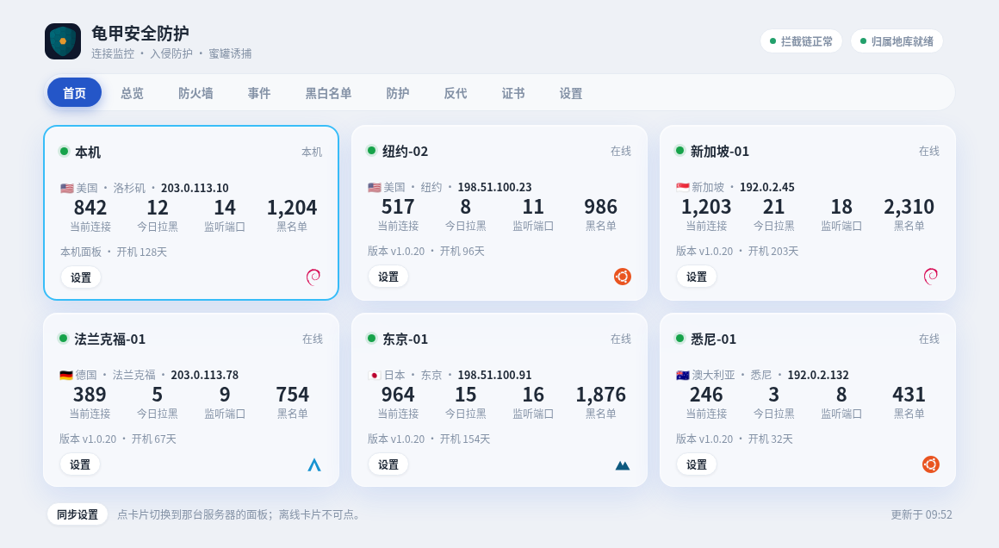
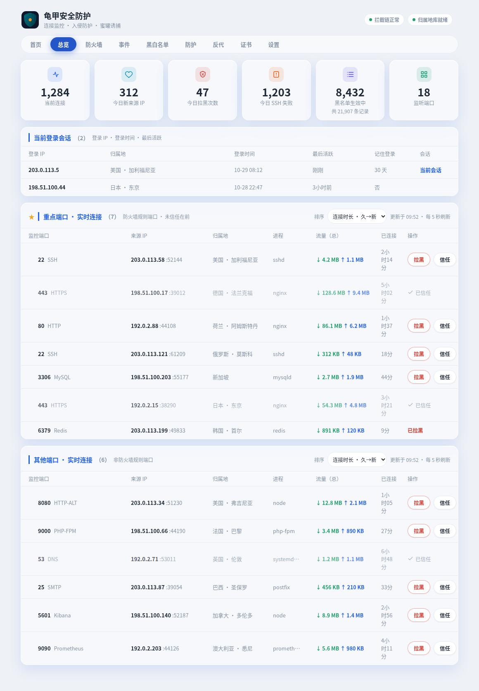

# 龟甲安全防护 Guijia 🛡️

[English](README.md) | 中文

龟甲是 Linux 服务器（VPS / 云服务器）的安全防护与监控面板：实时连接监控、入侵防护、蜜罐诱捕、多服务器群控。Go 单二进制 + nftables，systemd 或 Docker 运行。

> 飞牛 fnOS 应用版独立维护，不在这个仓库。

## 截图


*首页：多地区服务器群控（演示数据）。*


*总览：实时连接，按防火墙规则端口与其他端口分流（演示数据）。*

## 功能

### 📊 总览与实时连接

- 📊 6 张统计卡：当前连接、今日新来源 IP、今日拉黑次数、今日 SSH 失败、黑名单生效中 / 全部记录、监听端口。
- 🖥️ 首页服务器卡片：连接数、今日拉黑、端口数、黑名单、IP、归属地 + 国旗、系统 LOGO、开机时长、版本、有 IPv6 时显示。
- 📡 实时连接按防火墙规则端口与其他端口分流，可按时长或流量排序。
- 🔌 只封新连接，已建立的连接绝不踢掉。
- 👤 登录会话卡：登录 IP、归属地、登录时间、最后活跃、记住登录；会话只在内存里，面板重启后清空。

### 🧱 防火墙

- 🧱 规则 = 端口 + 协议 + 来源 + 动作（允许 / 拒绝）+ 启用开关；端口支持单个、逗号分隔与范围。
- ⚖️ 同一端口同一协议只能有一种动作；同动作多条规则按来源并集算；没有规则的端口防火墙不管。
- 🌍 8 种来源：自定义 IP、全部 IPv4、全部 IPv6、中国大陆境内、中国大陆境外、自定义位置（中国）、自定义位置（海外）、全部 IP。
- 🛡️ 内网、回环、保留段、信任名单永远豁免；拒绝封禁一律永久，直到规则删除、禁用或手动解封才释放。

### 📋 事件

- 📋 全部安全事件按时间倒序，可按类型筛选、按 IP / 详情搜索。
- 🗓️ 事件按天存文件，保留天数可调；新来源事件可单独设保留期，填 0 = 只计数、不记录。

### ✅ 白名单与黑名单

- ✅ 信任名单（IP / CIDR）：名单内 IP 不报警、不可拉黑；信任优先于黑名单与情报名单。
- 🏠 信任全部内网 IP：四段标准私网范围由后端隐式信任，绝不写进列表。
- 🚫 黑名单记录永久保留；到期、解封只改状态，不删记录。
- 🔍 手动拉黑 / 解封、按状态 / 来源筛选、按 IP 搜索；内网、回环、信任名单一律拒绝拉黑。

### 🔥 防护

- 🔥 端口洪峰防护：手动指定端口集合，单端口短时间内出现大量不同公网 IP 新连接时临时关闭该端口，内网不受影响，到期自动恢复，也可在防火墙页立即恢复。
- 💥 爆破自动拉黑：SSH 失败达到可调阈值即自动拉黑，封禁递进：首次 1 小时、再次 24 小时、累犯永久。
- 🔎 扫描识别（只看不探）：从内核连接表被动观察某 IP 短时间内触达的不同 TCP 端口数，达阈值即判定为扫描，闭口试探也能看见。
- 🍯 蜜罐：预置端口（SSH、RDP、Telnet、Redis、MySQL、Docker API、ADB、VNC 等）+ 自定义端口，合并去重；命中 N 次即封（默认 1 次），封禁时长默认 24 小时，填 0 = 永久。
- 🧪 蜜罐端口经分层校验，绝不能是真服务端口；蜜罐不提供真实服务、不仿真登录页面，对方数据只记录、不执行。
- 🆘 急救：Telegram 发 /rescue 打开急救菜单：信任 IP、解封全部、关闭所有拦截（30 分钟后自动恢复）、恢复防护；破坏性动作须输对超级密码，密码只存哈希。
- 🌐 威胁情报：只接公开聚合直链（默认 FireHOL level1，免费、无需 Key），独立 nft 集合全端口丢弃；拉取失败不断档，旧名单继续封禁，过期状态单独标示。

### 🔀 反代

- 🔀 一条规则 = 域名 + 监听端口 + 证书 + 内网后端；添加即启用，规则自带启用 / 停用。
- 🎯 精确域名优先于单层通配符（如 *.example.com）；同端口不同域名靠 SNI 分流；未匹配域名与直接 IP 访问一律拒绝。
- 🔗 上游格式为 http://IP:端口，https 后端不支持。
- ⚙️ 面板接管 nginx vhost 生命周期：启用生成 server 块，停用 / 删除即删块并 reload；nginx -t 不通过则全部还原；ACME 常驻块绝不动；只有面板跑 root 且本机有 nginx 时才接管，否则回落原有行为。
- ⚠️ 端口绑定冲突时规则行报占用进程名，而不是只有原始 bind 错误；反代面板本身时上游填 http://127.0.0.1:面板端口 即可。

### 🔒 证书

- 🔒 证书只有两个来源：在线申请（ACME）与手动上传；列表只显示元数据，绝不显示私钥。
- 📜 一张 SAN 证书覆盖多个域名，一行一个域名；通配符域名只能用 DNS-01。
- 🔑 挑战方式四档：自动（80 空闲走 HTTP-01，80 被占用走 DNS-01）、HTTP-01、DNS-01（Cloudflare）、nginx 代答（HTTP-01 经 nginx，不占 80、不用 Token）。
- 🔐 Cloudflare API Token 独立保存（0600 文件），面板只回星号占位，绝不明文回显。
- 🔄 每 6 小时检查一次，到期前 30 天自动续期，面板启动时也检查一次；自动续签开关可按证书关。
- 📊 状态：有效（绿）/ 已过期（红）/ 已吊销（红，OCSP 查）；每行可查看、下载（zip，含证书与私钥）、刷新、编辑、删除。

### 🖥️ 多服务器群控

- 📦 统一安装包、同一安装命令，没有单独 agent 包；任何独立服务器都可当主服务器。
- 🚪 首次打开面板二选一：设密码独立用，或填主服务器地址 + 配对码进群控。
- 📄 被群控节点本地面板变只读状态页，管理全在主服务器，不会出现两个面板打架。
- 🔑 配对码一次性、30 分钟有效、用完即废；主服务器待添加列表出现该节点（名字 + 指纹前 8 位 + 加入时间），点确认上线，同时双向白名单生效。
- 🔁 错码 / 过期 / 被拒绝直接在加入页 inline 报错，可无限重输；等待确认期间表单不可再改；只有临时断网才继续重试。
- 🚪 脱离：主服务器上移除管理，节点下次心跳被吊销后自动回到首次二选一界面；主服务器彻底没了时，节点本地命令 `guijia leave` / `guijia hub-code <配对码>` 兜底。
- 🗄️ 主服务器只存登记（名字、指纹、在线状态、最后在线、版本、TG 模式、节点上报的主 IP / 系统 / 架构、手动归属地）；防护数据全在各台本地，看节点 = 实时转发读。
- 🛡️ 防互 BAN 三护栏：节点拨号回家的流量走回程连接、节点豁免主服务器 IP、主服务器 link 端点失败只限流 + 记日志，永不进 nft 封禁。
- 👁️ 看节点时隐藏 2FA 卡、通用通知方式卡、当前登录会话卡、改密码行；节点 TG 通知卡保留；节点面板端口可改，改后管理不断。
- 🔔 新设备接入提醒：首页顶部提醒条，点「知道了」后落盘，重启 / 换浏览器后仍有效。
- 🔄 共享黑名单是全网并集：主服务器从各在线节点拉回完整记录，把没有的 IP 以 shared 条目并入，再推给全部在线节点；离线节点只记名跳过；节点本地条目不重复、不改动；主服务器已有 IP 绝不因合并改状态。
- ✅ 共享白名单不做并集：仍以主服务器为唯一源，旧 shared 条目按收敛移除，本机条目不动。
- 🔄 黑名单同步只做新增与状态同步（主服务器解封则节点条目变解封态，绝不硬删记录）；新节点批准后立即自动同步一次；同步先核实再报结果，超时幂等重试。
- ⚙️ 防护同步（洪峰、爆破、扫描、情报）跟主服务器走；同步设置在首页弹窗里，改动是草稿语义，保存才生效，间隔可选 5 / 10 / 30 / 60 分钟（默认 10 分钟），可立即同步。
- ⬆️ 主服务器上点一下可推升级给全部在线节点，单节点失败不影响其他节点。

### 🔔 通知与日报

- ✈️ Telegram 报警消息带服务器名标题、一键拉黑 / 一键信任按钮；按钮带服务器指纹，串台回调只提示不执行。
- 🔁 同一 bot token 同一时间只能一台服务器轮询命令；节点事件默认走主服务器 bot 统一发（标题带节点名），也可在节点切独立通知。
- 💾 主服务器挂了时节点事件本地攒着（ring buffer，有上限），重连后补推。
- 🎛️ 报警项目开关 10 项，统一在通知配置弹窗里管理。
- 📰 TG 日报每天定时推送当日摘要，时间可设；事件日志保留天数、新来源事件保留期在同一卡片里可调。

### 🔑 登录安全

- 👤 单管理员，不做多用户；首次登录强制设密：12 位起，含大写、小写、数字、符号，两次确认。
- 🍪 保存登录（30 天）可选；面板重启后内存 session 清空，需重新登录。
- 🚫 面板防爆破：密码连续错 5 次（次数可调）封 IP 7 天，中间成功一次清零；内网与信任名单豁免；进统一黑名单，7 天到期自动解封。
- 🌐 真实 IP 判定：只在经本机回环（nginx 反代）时信 X-Real-IP / XFF，直连面板端口不信，防伪造。
- 📱 2FA（手动开，默认关）：Go 端本地生成二维码 PNG（不走外部在线二维码 API）+ 手动密钥文本；开通须输对一次动态码；开通弹窗有「换一个」按钮（每次现生成，旧密钥立即作废）；成功后弹窗内显示 10 个一次性恢复码，只显示一次；关闭 2FA 须密码确认。
- 💻 信任设备：验证通过即信任该设备（设备 cookie + 绑定真实 IP，落盘 0600 文件，90 天有效），换 IP 或换设备才重新输动态码；改密、关 2FA 时清空全部信任。
- 🛠️ 忘密码用服务器本地 root 命令：`guijia reset-password`；证书出问题进不去时用 `guijia cert-off` 关 HTTPS 回 HTTP。

### 📈 流量统计与账本

- 📈 每条连接的流量数字来自内核连接字节计数（nf_conntrack_acct）；开启后应用在启动时自动打开它，退出时把自己打开的开关恢复原样，原本已开着的不动。
- 💰 累计账本：每个对端的历次连接总量，永久保留、只增不减，仅可在数据清理里手动清空。
- 🗓️ 每日明细保留天数可调，填 0 = 永久保留。

### 🗺️ 归属地库

- 🗺️ IPv4 库内置兜底 + 手动检查更新；IPv6 库默认不下载，设置页手动下载。
- 🚩 归属地与国旗：手动归属地优先于自动解析，留空清除回自动解析。
- 📍 防火墙位置来源：中国省份 + 城市、海外国家 + 地区，中英文双语显示、中英文均可搜索。

### 🧹 数据清理、备份恢复与升级

- 🧹 数据清理弹窗：清空事件与统计、黑名单、流量账本；每菜单单独清空或全部清空，YES 二次确认，清空后不可恢复。
- 💾 备份与恢复弹窗：设置备份（一个 JSON 下载）、数据备份（一个 zip 下载）；裸 settings.json 误传进来时绝不当成「空配置」恢复，有拦阻。
- 🔀 设置保存按字段合并：UI 不再提交的旧值不会被清零。
- ⬆️ 版本与升级：从 GitHub releases 检测新版，点一下升级，失败自动回滚；升级完成后自动刷新页面，重启后需重新登录。
- ✅ 升级失败状态按实际版本复核：正在跑的版本就是目标版时自动纠正为成功；升级备份按修改时间留最新 3 份。

### ⌨️ 命令行

- ⌨️ `guijia reset-password` · `guijia cert-off` · `guijia unban <ip>` · `guijia leave` · `guijia hub-code <配对码>` · `guijia nginx-ensure` · `guijia nginx-status` · `guijia upgrade-watch`。

## 安装

### 要求

- Debian / Ubuntu，root，systemd（或 Docker）；架构 arm64 / amd64 自动识别。
- 面板默认端口 59188，数据目录 `/var/lib/guijia`，均可配置。

### 一键安装（推荐，systemd）

```bash
curl -fsSL https://raw.githubusercontent.com/pal537/GuiJia/main/install-remote.sh | sudo bash
```

脚本会：识别架构 → 从本仓库 releases 拉对应包 + `guijia.service` → 先验 sha256（不过不装）→ 装到 `/usr/local/bin/guijia`、建数据目录、enable + restart → 健康检查并打印面板地址。重跑即升级（幂等）；旧二进制与旧单元先备份到 `/root/guijia-install/`，重启失败自动还原，不留半装状态。

钉版本、改端口 / 数据目录（装前用环境变量传，会写进 `/etc/default/guijia`；传变量时一键命令改用 `sudo -E bash`，否则 sudo 会丢环境变量）：

```bash
curl -fsSL https://raw.githubusercontent.com/pal537/GuiJia/main/install-remote.sh | sudo -E bash
# 钉版本（默认 latest）：GUIJIA_VERSION=v1.0.20；改端口 / 数据目录：GUIJIA_PORT / GUIJIA_DATA_DIR
```

### Docker

仓库目前没有发布 Docker Hub 镜像，Docker 方式是本地构建，host 网络 + NET_ADMIN 是必需的：

```bash
git clone https://github.com/pal537/GuiJia.git && cd GuiJia && docker compose up -d --build
```

```bash
GUIJIA_PORT=59188 docker compose up -d
GUIJIA_DATA_DIR=/srv/guijia docker compose up -d   # 默认 ./guijia-data，容器内固定 /var/lib/guijia
```

### 手动部署（从 releases 拿包）

```bash
# 从本仓库 releases 下载对应架构包 + guijia.service + SHA256SUMS，验签通过后再装
install -m 0755 guijia-linux-<arm64|amd64> /usr/local/bin/guijia
systemctl restart guijia
```

装完必验：`sha256sum /usr/local/bin/guijia` 与 releases 一致，`systemctl is-active guijia` 为 active，面板本地 `curl http://127.0.0.1:59188/login` 为 200。

## 首次使用

打开 `http://服务器IP:59188`（端口按实际改），先设管理员密码，再二选一：

- **独立用**：设密码后即为独立面板
- **进群控**：填主服务器地址 + 配对码，加入后本地面板变只读状态页，管理全在主服务器

管理命令：

```bash
systemctl status guijia
systemctl restart guijia
journalctl -u guijia -f
```

忘密码用服务器本地 root 命令：`guijia reset-password`。面板重启后内存 session 清空，需重新登录。

## 链接

- [Releases](https://github.com/pal537/GuiJia/releases)
- [Issues](https://github.com/pal537/GuiJia/issues)
- [INSTALL.md](INSTALL.md) · [DEPLOY.md](DEPLOY.md) · [DESIGN.md](DESIGN.md)

## 作者

pal537
